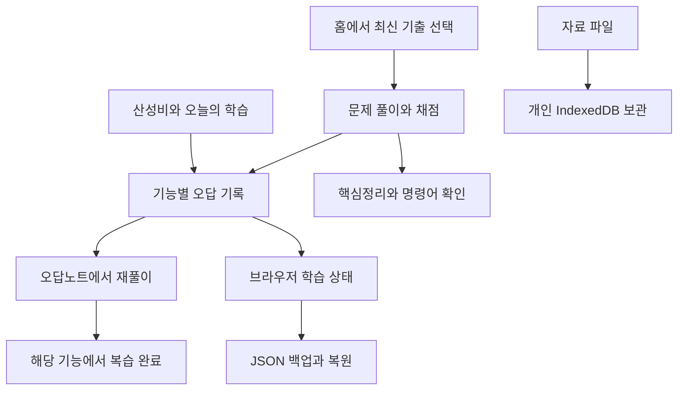

# 합격루틴 구조와 기술 선정 이유

## 목적과 범위

현재 목적은 네트워크관리사 2급 필기 문제 반복·오답 복습·핵심 개념 확인이다. 계정·결제·공유 DB가 없는 정적 앱으로 운영한다. 예시 DOCX에서는 ‘조건 → 기술 선정 → 구조 → 데이터 → 배포 → 검증 → 미결정 사항’의 설명 순서를 참고했다. 예시에 등장하는 내부망·eGovFrame·Oracle·SVN 구성을 이 서비스의 요구사항으로 취급하지 않는다.

## 사용자와 데이터 흐름



실제 상태를 바꾸는 이벤트는 앱 조립부가 연결한다. `core.cleanState`는 가져온 데이터의 ID·답안·시간·점수를 정제하고, `WrongNotebook`은 출처별 오답을 관리한다. 화면은 저장 규칙을 재구현하지 않는다. 게임 GP는 학습 정답률에 합치지 않는다.

## 모듈 책임과 수정 위치

| 관심사 | 파일 | 바꿀 때 확인할 것 |
|---|---|---|
| 조립·공통 상태·이벤트 위임 | `assets/network/app.js` | 경로 전환, 저장, 가져오기 후 최신 상태 |
| 홈·학습 계획 | `pages/home-pages.js` | 최신 회차·복습·체크 상태 |
| 문제풀이 컨트롤러 | `pages/quiz-page.js` | 회차 필터·답안·채점·실전 마감·오답 |
| 설정·기록 입출력 | `platform/settings-controller.js` | 확인 다이얼로그·JSON 백업/가져오기 |
| 키워드·명령어·핵심정리 화면 | `pages/reference-pages.js` | 검색·분류·읽음·펼침·레이아웃 |
| 기능별 오답 화면 | `pages/wrong-notebook-page.js` | 필터·재풀이·해당 출처만 완료 |
| 오답 저장 규칙 | `domain/wrong-notebook.js` | 중복·레거시 이관·출처별 상태 |
| 계산·학습 상태 정제 | `domain/core.js` | IPv4 경계값·위조/알 수 없는 ID |
| 복습 선택·간격 | `domain/review-core.js` | 시험일 상한·날짜·반복 제한 |
| 오늘의 학습 화면 | `pages/daily-study.js` | 확인 즉시 오답 전달·평가·중복 방지 |
| 산성비·배지·게임 백업 | `pages/keyword-game.js` | 90초·일시정지·모드별 최고점·정답 목록 |
| 학습 추천 | `ui/study-coach.js` | 7일 활성 시간·근거 수치·숨기기 |
| 기능 검색 | `ui/feature-helper.js` | 동의어·검색 연결·재열기 초기화 |
| 자료 화면/저장 | `pages/materials-page.js` / `platform/materials-store.js` | 파일 검증·중복·ZIP·IndexedDB 실패 |
| 내비게이션·테마·PWA | `platform/navigation.js` / `platform/themes.js` / `platform/pwa.js` / `sw.js` | 뒤로가기·시스템 테마·업데이트·오프라인 |

`index.html`의 defer 순서로 데이터 → 규칙 모듈 → 화면 모듈 → 조립부를 로드한다. ES modules로 일괄 변경하면 `file://` 열기와 충돌할 수 있어 현재는 이름을 가진 IIFE 전역 모듈을 유지한다. 화면 모듈은 `getState()`로 상태를 받아 가져오기·초기화 후 예전 객체를 계속 참조하지 않게 한다.

## 기술별 선정과 전환 조건

| 현재 선택 | 현재 적합한 이유 | 다른 도구가 유리해지는 상황 |
|---|---|---|
| HTML/CSS/JavaScript 정적 앱 | 빌드 없이 파일 열기·정적 호스팅, 서버 비용과 API 키 없음 | 협업 화면·복잡한 상태와 반복 컴포넌트가 크게 늘면 프레임워크와 번들러 도입 검토 |
| localStorage | 작고 즉시 필요한 학습 진행 상태 | 기기간 동기화·계정 복구·여러 사람이 공유하는 상태는 인증+서버 DB 필요 |
| IndexedDB | 개인 문제지 Blob과 메타데이터 보관 | 다중 기기 파일 공유는 권한·용량 정책을 갖춘 서버 저장소 필요 |
| Service Worker | 설치·오프라인 사용 | 캐시가 데이터베이스나 중앙 백업을 대체하지는 않음 |
| 규칙 기반 도우미 | 기능 위치 찾기에 충분, 입력 외부 전송·운영 API 비용 없음 | 검증된 자료 인용을 포함한 자유 질문 상담이 필요하면 서버 프록시·비용 제한·평가·개인정보 정책까지 함께 설계 |
| Node 내장 테스트 | 별도 테스트 프레임워크 설치 없이 도메인·DOM 모형 검사 | 실제 기기 자동화·접근성 전수 검사가 필요하면 별도 브라우저 테스트 체계 필요 |
| Prettier 3.6.2 일회 실행 | 긴 수작업 코드를 일정한 서식으로 정리 | 개발자 수가 늘면 승인된 개발 의존성·버전 고정을 프로젝트에 도입 |

선정 근거는 브라우저 [localStorage](https://developer.mozilla.org/en-US/docs/Web/API/Window/localStorage), [Service Worker](https://developer.mozilla.org/en-US/docs/Web/API/Service_Worker_API/Using_Service_Workers), [Prettier 공식 안내](https://prettier.io/docs/install)도 참고했다. 프레임워크 도입 자체가 유지보수성을 보장하지 않으므로 현재 책임 분리와 회귀 검사를 먼저 적용한다.

## 저장과 호환성

- `network-notes:v1`: 암기·읽음·계획·연습 답안·복습 일정·`wrongByFeature`. 기존 `wrong` 배열은 문제 항목 합집합으로 유지한다.
- `network-keyword-rain:v1`: 4지선다/입력 최고점, 누적 GP. 학습 JSON의 `gameProgress`에 함께 백업한다. 해당 필드가 없는 구버전 백업은 기존 게임 기록을 지우지 않는다.
- `network-study-coach:v1`: 최근 7일 이용 시간과 하루 숨김. 개인 학습 JSON에 포함하지 않는 보조 추천 기록이다.
- 테마와 시험 자료 파일은 각 모듈의 브라우저 저장소에 보관한다. JSON 백업이 자료 파일 원본까지 포함하지 않는다.

파일·localhost·실제 HTTPS 도메인은 같은 저장 공간이 아니다. `file://`의 저장 동작도 브라우저별 차이가 있으므로 중요한 기록은 내보내기로 보관한다. 계정 동기화는 구현하지 않았다.

## 코드 작성 원칙과 남은 부채

명령을 설명하는 화면에서 실제 명령을 실행하지 않는다. 사용자 입력과 파일명은 HTML 출력 전에 이스케이프한다. 원천 학습 데이터·ID는 생성 스크립트에서 관리하고 포매터로 불필요하게 재작성하지 않는다. 주석은 책임·데이터 경계·해제 시점·호환성 이유를 설명한다.

홈·계획·문제풀이·설정은 별도 모듈로 분리했다. app.js에는 공통 상태·라우팅·키워드 상호작용과 이벤트 위임이 남아 있다. HTML 템플릿 문자열과 이전 반응형/테마 규칙은 더 정리할 여지가 있으므로 ‘클린코드 완성’으로 선언하지 않는다. 다음 변경도 저장/화면 회귀 검증과 함께 진행한다.


## CSS 모듈과 로딩 순서

`assets/network/css/`에 foundation, reference, assessment, progress-dialogs, responsive, study-layout, keyword-examples, materials, latest-paper, daily-pwa, navigation-layout, keyword-disclosure, paper-library의 13개 파일을 둔다. 공통 스타일과 여러 학습 화면에서 공유하는 답안/진행 UI는 함께 유지했다.

실제 HTML은 index의 link 순서로 로드한다. 기존 styles.css/mobile.css는 기존 경로를 사용하는 경우를 위한 import 진입점이다. 분리 시 원본 규칙 순서를 그대로 유지했고, 모듈을 순서대로 합친 내용의 SHA256이 원본과 동일함을 확인했다. 근거는 audits/css-module-split.json이다. 이 기록은 분리 당시의 무변경 증거이며 이후 정당한 CSS 수정을 금지하는 테스트가 아니다.

다른 모듈로 규칙을 옮길 때 선택자 우선순위·@media 범위·전후 순서를 확인한다. 기존 반응형 규칙은 공유하는 화면이 많아 responsive/study-layout 모듈로 보존했다. 파일 수만 늘리는 대신 앞으로 바뀌는 규칙의 책임 범위를 좁혀간다.

## 2026-11-13 폴더 경계 정리

루트 README는 사용/개발 진입점이고 학습 원문은 `docs/study/exam-guide.md`다. 생성 스크립트 입력을 새 원문으로 바꿨으며 기존 문항 ID·저장 키를 유지한다. `docs/features.md`는 기능 인벤토리, `docs/settings.md`는 설정·저장 계약이다.

```text
assets/network/
  app.js       공통 상태·라우팅·이벤트 연결
  data/        학습 데이터·회차 인덱스·공개 자료 목록
  domain/      순수 계산·복습·상태 정제·오답 규칙
  pages/       화면 렌더링과 해당 화면의 상호작용
  platform/    브라우저 저장·대화상자 설정·테마·경로·PWA
  ui/          공통 출력·키워드 배치·기능 검색·학습 추천
  css/         공통/기능별 스타일 (로드 순서 보존)
  icons/       앱 아이콘
  papers/      원본 문제의 표·그림
scripts/       생성·다운로드·검사 도구
tests/         Node 회귀 테스트
  support/     브라우저 스크립트 경로 탐색 등 테스트 공통 코드
docs/          현재 기능·설정·구조·운영 문서
  guides/      사용 안내
  study/       학습 원문과 공부 계획
  history/     당시 구현 기록
  development/ 질문·실행·승인 일지
  learning/    기술 개념·선택 이유
materials/     공개 자료·원본 (source 포함)
audits/        당시 검증 증거
work/          일회 작업과 중간 결과 (런타임 의존 금지)
```

루트의 `sw.js`는 서비스 워커 범위를, manifest는 앱 시작 경로를 유지한다. `.nojekyll`, `_config.yml`, 포매터 파일, AGENTS는 도구가 찾는 진입점이므로 루트에 남긴다. 루트 파일을 두 개만 남기기 위해 이 파일을 옮기면 설치/오프라인이나 도구 설정이 달라질 수 있다. `.git`, `.idea`, `.agents`와 다른 프로젝트 보관 폴더는 임의 삭제하지 않는다.

공통 제목·빈 상태·HTML 이스케이프는 `ui/page-ui.js`로 분리하고 app이 페이지에 필요한 함수를 주입한다. 도메인 모듈은 UI에 의존하지 않는다. VM 테스트의 `tests/support/browser-path.cjs`는 실제 파일명을 재귀 탐색하고 중복 파일명을 오류로 처리해 테스트에 폴더 맵을 반복 복제하지 않는다.

체커는 자산 하위 폴더의 JS를 재귀 검사하며 index 참조·서비스 워커 문서/자산·CSS import/url을 확인한다. PWA 등록 스크립트는 `platform/` 이동에 맞춰 루트 워커까지의 상대 깊이를 갱신했다. 자료 ZIP도 새 `data/public-materials.js` 경로를 사용한다.

상세 파일별 수정 위치는 [파일 지도](file-map.md)를 참조한다. 옛 경로와 새 경로 대응은 `audits/structure-migration-2026-11-13.json`에 기록했다. HTML 템플릿의 길이와 이전 반응형 스타일 중첩은 남아 있는 부채이며 프레임워크 전환이나 모든 중복 제거를 완료했다고 해석하지 않는다.

## 이론 그림과 사용자 안내 (v23)

`ui/theory-visuals.js`는 단원 ID에 맞는 보조 개념 그림을 HTML/CSS로 출력한다. 학습 원본과 점수·저장 상태를 변경하지 않는다. 원본 HTML은 기존 생성 데이터를 그대로 표시하며 그림 아래에서 읽는다. bitmap 대신 코드 기반 도식으로 확대·줄바꿈·테마와 텍스트 접근성을 유지했다. 공식 정답/검토 상태는 기존 안내와 일치시킨다.

`pages/user-guide-page.js`는 #help의 정적 설명 화면이다. 홈·설정·기능 검색에서 연결한다. `css/theory-visuals.css`는 새 도식/안내 책임을 갖고 기존 참고 화면/테마 CSS 뒤에서 로드해 예전 reader 문단 색이 어두운 테마의 도식에 덮어쓰이지 않게 했다. 기존 CSS의 순서는 유지한다.

본문 내부 이동은 data-scroll-target으로 표시하고 app이 같은 문서의 대상에 스크롤/포커스를 옮긴다. 앱 라우팅 해시를 새로 만들지 않는다. 목차는 모바일에서 처음에 접혀 있으며 브라우저 기본 details 조작으로 열 수 있다. 화면을 넓히더라도 summary를 남겨 닫힌 목차에 접근할 수 있다. 새 상태나 별도 리스너는 없다.
