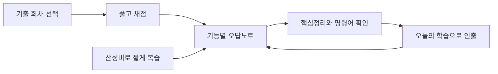

# 기능 목록과 사용 흐름

## 기출 자료 조회 (v27)

모든17개 공부방의 `#sources`에서 최근5년74회차 출처를 조회한다. 연도(최근3년/5년/개별 연도)와 개정 구분을 함께 적용하고 최신순으로 표시한다. 목록 확인만 된5회차·복원 중·기존 출처·공식기관/CBT를 구별한다. 답안게시4건과 출판사 연도묶음8건은 별도 영역으로 표시하며 회차 수에 합치지 않는다.

선택 화면은 시험별 출처 개수, 공부방 홈은 ‘연도별 기출 자료 보기’, 메뉴는 ‘기출 자료’를 제공한다. 네트워크는 기존 수록 문제풀이로 이동할 수 있다. 다른 시험은 원문 연결이며 신규 채점 문제를 제공하지 않는다.0건 시험의 공백과 CCNA의 실제 시험 덤프 미제공도 표시한다. 외부 페이지는 새 탭에서 열며 자동 다운로드/수집/정답 판정은 하지 않는다.

확인 원본은 `docs/research/paper-inventory-2022-2026.json`, 생성 자산은 `data/exam-paper-sources.js`, 화면은 `pages/paper-sources-page.js`다. 출처 링크 공개는 원문 콘텐츠 재게시 허가 취득을 뜻하지 않는다.

확인 기준: 2026-11-16, 로컬 소스 v27. 실제 구현 기능과 운영상 한계를 함께 정리한다. 각 파일은 `assets/network/` 아래 상대 경로다.

## 현재 시험 선택 (v26)

조사한17개 시험을 선택할 수 있다. 네트워크관리사2급1개만 학습 가능하고 나머지16개는 공통 공부방의 준비 상태다. 이름 검색(구 명칭/영문 별칭 포함)과6개 분야 필터를 함께 적용하며 재진입 시 초기화한다. 프로그래밍기능사는 첨부에서 신규 대상이 아니므로 선택 목록에 추가하지 않았다. 개인의 보유/합격 상태는 기본값으로 넣지 않았다.

`data/exam-catalog.js`가 시험명·분야·단계·공식 경로·준비 여부를 관리한다. 분야는 탐색용 분류이며 공인 지위·응시자격·난도 판정이 아니다. 모든 신규 시험의 실제 문제·해설·학습 저장 기능은 미제공이다. 리눅스/PC Master는1·2차, CCNA는 자격시험으로 표시하며 다른 시험에 네트워크14일 계획을 그대로 약속하지 않는다.

## 학습 화면

| 화면·주소 | 제공 기능 | 담당 모듈 | 저장·주의점 |
|---|---|---|---|
| 학습 현황 `#dashboard` | 최신 기출·5분 복습 바로가기, 시험일까지 남은 날, 복습 수·최근 정답률·연속 학습, 진행 중 문제 이어풀기, 하루 목표, 기능별 진입 배너 | `pages/home-pages.js` | 숫자는 현재 브라우저 기록 기준 |
| 오늘의 학습 `#daily`, `#daily/5` | 5/12/25분·자유 학습 선택, 범위 선택, 개념 소개, 복습 기한·취약·미학습 순서의 혼합 문제, 답·해설 확인, 선택 메모, 모름/헷갈림/기억남 평가, 결과와 추가 학습 | `pages/daily-study.js`, `domain/review-core.js` | 오답 확인 즉시 저장. 맞혔어도 모름/헷갈림이면 복습 목록. 오답 또는 모름은 세션당 한 번 재출제. 한 세션 자체가 무제한은 아님 |
| 키워드 암기 `#keywords` | 54개 단서 카드, 검색·분류·미암기 필터, 암기 체크, 접이식 문제 예시·보기·해설·함정 | `pages/reference-pages.js`, `ui/keyword-layout.js` | 암기 상태와 예시 오답을 기록. 답 번호 암기보다 조건 구별을 돕는 자체 예시 |
| 핵심정리 `#theory`, `#theory/번호` | 12단원 개념 그림·카드·화살표·서브넷 64칸 그림, 모바일 접이식 목차, 본문 바로가기, 자기 확인, 읽음 표시, 서브넷 계산기 | `pages/reference-pages.js`, `ui/theory-visuals.js`, `domain/core.js` | 읽음 상태 저장. 계산 결과는 실제 명령 실행이 아님 |
| 명령어 노트 `#commands` | 87개 명령/설정 항목, 목적·문법·옵션·주의사항 검색과 분류 | `pages/reference-pages.js` | Windows/Linux/네트워크 명령 설명이며 기기에 명령을 실행하지 않음 |
| 문제 풀이 `#quiz`, 최신 회차 `#quiz/current` | 2022~2026 연도 선택, 개정 이후 필터, 회차 선택·반복 풀이, 10문제 연습, 자체 50문제 50분 실전, 답안 이동·정답 확인·채점·해설, 중단 후 이어풀기, 최근 결과 | `pages/quiz-page.js`, `data/paper-archive.js` | 확보된 17회차 850문항과 자체 72문항. 원본 확보 대기는 문제 수에 포함하지 않음. 회차 풀이와 자체 실전은 구분 |
| 오답노트 `#wrong` | 오늘의 학습·산성비·키워드·자체 연습·기출·이전 기록별 필터, 키워드와 문제 다시 풀기, 해당 출처 복습 완료 | `pages/wrong-notebook-page.js`, `domain/wrong-notebook.js` | 같은 문제라도 기능별 기록 유지. 전체 개수만 중복 제거. 한 기능에서 완료해도 다른 출처는 유지 |
| 키워드 산성비 `#game` | 90초 게임, 4지선다/직접 입력, 일시정지, 모드별 최고점·연속 정답·GP, 배지, 종료 후 정답 목록 펼치기·선택 답과 놓친 단서 복습 | `pages/keyword-game.js` | 게임 점수와 시험 점수는 별개. 배지는 모드별 한 판 성과를 사용. 오답은 산성비 출처로 저장 |
| 시험 자료 `#materials` | 드래그 드롭·파일 선택, 공개/개인 자료 목록, 검색·분류, 지원 형식 미리보기, 원본 다운로드, 제목·연도·회차·메모 편집, 검토 표시, 중복 방지, 선택 자료 ZIP 내보내기 | `pages/materials-page.js`, `platform/materials-store.js` | 개인 파일은 IndexedDB에 보관. 파일당 30MB 이하. HWP 등은 원본 다운로드가 필요할 수 있음. 파일 투입이 자동 퀴즈 생성이나 서버 업로드를 의미하지 않음 |
| 14일 학습 계획 `#plan` | 날짜별 학습 주제·완료 체크, 시험일에 따른 진행일 안내 | `pages/home-pages.js` | 시험일과 완료 상태 저장 |

자료 수는 현재 확보본 기준이다. 회차를 추가하면 이 표와 생성/검증 결과를 함께 갱신한다. 2026년 4회차 정답·해설은 학습용 풀이로 공식 정답표 대조 미완료 상태를 숨기지 않는다.

## 쉬운 사용법

홈의 ‘1분 사용법’, 설정의 사용법 링크 또는 공부 도우미의 ‘사용법’ 검색으로 `#help`를 연다. `pages/user-guide-page.js`가 문제 고르기 → 답/이유 보기 → 오답 복습을 안내한다. [짧은 설명서](guides/quick-start.md)는 내려받아 읽을 수 있다. 사용법은 새 로그인·저장소·외부 요청을 만들지 않는다.

## 모든 화면에서 사용하는 기능

| 기능 | 행동 | 담당 코드 |
|---|---|---|
| 공부 도우미 | 오른쪽 아래에서 기능명을 검색하고 해당 화면으로 이동. 다시 열 때 이전 검색을 초기화 | `ui/feature-helper.js` |
| 학습 방법 추천 | 최근 7일 활성 사용 시간과 자료 비교 근거로 다른 학습 수단 제안·당일 숨김 | `ui/study-coach.js` |
| 반응형 메뉴 | 화면 폭에 맞춘 상단·하단 메뉴와 현재 위치 표시, 뒤로가기 처리 | `platform/navigation.js`, `css/navigation-layout.css` |
| 설정 | 시험일·테마·설치/업데이트·JSON 기록 관리 | [설정 명세](settings.md) |
| PWA | 지원 브라우저에서 설치, 오프라인 자산 준비, 업데이트 안내와 갱신 | `platform/pwa.js`, 루트 `sw.js` |
| 접근성 기초 | 본문 건너뛰기, 버튼/입력 이름, 대화상자, 현재 메뉴 표시, 키보드 포커스 | `index.html`, 화면/CSS 모듈 |

## 대표 학습 흐름

오늘의 학습만 반복하려면 완료 화면의 추가 학습을 사용한다. 현재 추천은 주로 기능별 자료 충족도와 이용 시간에 기반하며 사람의 실제 시험 점수나 합격 확률을 예측하지 않는다. 근거·가정은 [7일 계획](study/study-plan-7-days.md)에 있다.

## 구현하지 않은 것

계정/기기간 자동 동기화, 중앙 서버 백업, 외부 AI 상담, HWP/PDF 자동 문제 추출·정답 검수, 자동 게시, 문의 접수 서버는 구현하지 않았다. 사용자 데이터가 서버로 보관된다고 안내하지 않는다. 브라우저 데이터 삭제·주소 변경 전에 백업 범위를 확인한다.

## 검증과 수정 위치

코드 변경 후 `node scripts/check-site.cjs`를 실행한다. 실제 설치·오프라인·모바일 입력은 [운영 절차](operations.md)대로 별도 확인한다. 기능이 추가되면 이 목록, [구조](architecture.md), [설정](settings.md), 필요한 테스트를 함께 갱신한다.
# v25 시험 선택과 두 공부방 (2026-11-16)

주소를 처음 열면 `#exams`에서 네트워크관리사2급/PC정비사2급을 고른다. `?exam=network#dashboard`는 기존 학습 기능, `?exam=pc#dashboard`는 같은 메뉴/컨테이너의 자료 준비 화면이다. PC정비사 신규 문제는0개이며 풀이·산성비·오답 저장은 아직 열지 않았다. 다른 시험 문제로 대체하지 않는다. 상단 ‘시험 변경’으로 돌아간다.

기존 `#dashboard`, `#quiz`, `#theory/1` 등 query 없는 직접 주소는 네트워크관리사로 유지된다. PWA 신규 실행 주소는 `./#exams`다. 실제 설치 앱의 기존 바로가기 갱신은 별도 확인이 필요하다. 담당 코드는 `pages/exam-workspace.js`, 공통 셸은 기존 index/CSS를 사용한다.

## 2026-11-16 시험별 학습 업데이트

17개 시험에서 공통 학습 화면을 사용합니다. 네트워크관리사 2급은 기존 기출을 유지하고, 다른 16개는 자체 제작 기초 연습 20~30문항·해설·오늘의 학습·키워드 예시·산성비·기능별 오답·핵심정리·14일 계획을 제공합니다. 실제 기출/전 범위/공식 검수 완료를 뜻하지 않습니다. 상세 경계와 추가 방법은 [시험별 학습 설계](exam-learning.md)를 참고하세요.

### v29 시험별 화면 비교 수정

홈·사용법을 공통 렌더러로 통합해 시험일 설정/이어가기/복습 현황/오늘 목표를 제공한다. 확장 시험의 학습 추천은 시험별 활성 시간만 사용하고 네트워크 점수 근거를 표시하지 않는다. 추천 기록은 `cert-coach:{id}:v1`이며 학습 JSON 백업 대상이 아니다. [비교·검증 결과](exam-parity-2026-11-16.md)를 참고한다.

## v30 맞춤 연습과 로그인 금지 원칙

문제풀이에서 단원/검색/출처/미학습/오답/북마크/문제 수를 고르고 동일 문제를 다시 풀 수 있다. `core.js`는 선택 규칙과 북마크/연습 종류의 가져오기 정제를, `quiz-page.js`는 입력/시작/반복/표시를 담당한다. 북마크는 시험별 학습 JSON에 포함된다. 로그인·회원가입·계정·인증 서버 및 학습 기록 외부 업로드는 사용자 명시 재지시 전까지 추가하지 않는다. [사용법·구조·범위](custom-practice.md) 참고.

## v31 사용자 제공 실제 기출

PC정비사 14회차700문항·리눅스마스터9회차720문항·정보처리기사7회차700문항을 최신/연도별 풀이·맞춤 연습·기출 오답·북마크·오늘의 학습에 연결했다. 제공 상세 해설840개. 키워드/이론 콘텐츠는 기존 기초 범위다. [원본과 검증](imported-papers.md).

## v32 공개 라이선스 연습

CC BY4.0 네트워크 교재의 번역·수정12문항을6시험의 문제풀이에 추가했다. 공개 연습 시작/맞춤 출처 필터와 채점·오답·북마크·복습에 연결한다. 기출 회차로 세지 않는다. [출처·범위·검증](licensed-practice.md).

## v33 오답 순차 복습과 화면 잠금

오답 목록의 ‘차례로 풀기’에서1/N·이전/다음·문제번호입력을 제공한다. 정답 후에도 현재문제/해설을 유지하며 해당출처만 완료한다. 일반문제와 오답의 이동 뒤 새문제로 포커스를 복구한다. 6자리 고정코드의 간단한 화면잠금을 추가했으며 서버인증/파일접근제어가 아니다. [설정과 한계](settings.md).

## v34 실기 준비·가상 실험실

네트워크관리사2급 홈에서 실기준비(#practical), 가상실험실(#lab)로 진입한다. 12/19응시일 기준 로드맵과8개따라하기, IPv4입력창·부분CLI·케이블배치의6조건 테스트를 제공한다. 실제OS/장비/공식시험 재현이 아니다. 완료/응시일만 학습JSON에 보존하고 장비상태는 탭메모리에 둔다. 날짜입장코드는 한국오늘날짜로 매일변경하고 자정/탭복귀에서 만료한다. [사용법·근거·검증](practical-lab.md).

## v35 실기 조작 기억 돕기

Windows 연결/이더넷/IPv4 속성과 자동·수동·확인/적용/취소, IOS 모드별 문법 오류와 저장 확인, 케이블 드래그 배치와 선 교환을 추가했다. 모바일은 색 선택 후 핀 터치를 유지한다. [사용법과 검증 한계](practical-lab.md#v35-추가-검증과-한계).

## v36 실기 중심 홈·조건별 진단

네트워크 홈의 필기 복습 도구는 기본 접힘으로 제공한다. 실험실은 미충족의 실제 값·확인 방법·설정 이동을 제공하고 검사 후 변경 여부, 라우터 모드/저장 상태를 표시한다. show 조회는 이전 결과를 만료시키지 않는다. 필기 14일 계획에서 실기 로드맵으로 이동할 수 있다. 결과 강조는 짧게 표시하며 움직임 최소화를 존중한다.
