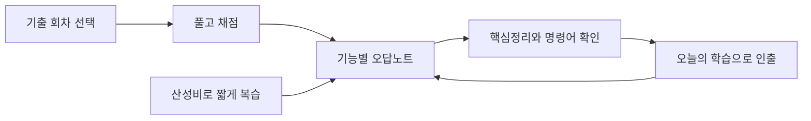

# 기능 목록과 사용 흐름

확인 기준: 2026-11-15, 로컬 소스 v23. 실제 구현 기능과 운영상 한계를 함께 정리한다. 각 파일은 `assets/network/` 아래 상대 경로다.

## 학습 화면

| 화면·주소 | 제공 기능 | 담당 모듈 | 저장·주의점 |
|---|---|---|---|
| 학습 현황 `#dashboard` | 최신 기출·5분 복습 바로가기, 시험일까지 남은 날, 복습 수·최근 정답률·연속 학습, 진행 중 문제 이어풀기, 하루 목표, 기능별 진입 배너 | `pages/home-pages.js` | 숫자는 현재 브라우저 기록 기준 |
| 오늘의 학습 `#daily`, `#daily/5` | 5/12/25분·자유 학습 선택, 범위 선택, 개념 소개, 복습 기한·취약·미학습 순서의 혼합 문제, 답·해설 확인, 선택 메모, 모름/헷갈림/기억남 평가, 결과와 추가 학습 | `pages/daily-study.js`, `domain/review-core.js` | 오답 확인 즉시 저장. 맞혔어도 모름/헷갈림이면 복습 목록. 오답 또는 모름은 세션당 한 번 재출제. 한 세션 자체가 무제한은 아님 |
| 키워드 암기 `#keywords` | 54개 단서 카드, 검색·분류·미암기 필터, 암기 체크, 접이식 문제 예시·보기·해설·함정 | `pages/reference-pages.js`, `ui/keyword-layout.js` | 암기 상태와 예시 오답을 기록. 답 번호 암기보다 조건 구별을 돕는 자체 예시 |
| 핵심정리 `#theory`, `#theory/번호` | 12단원 개념 그림·카드·화살표·서브넷 64칸 그림, 모바일 접이식 목차, 본문 바로가기, 자기 확인, 읽음 표시, 서브넷 계산기 | `pages/reference-pages.js`, `ui/theory-visuals.js`, `domain/core.js` | 읽음 상태 저장. 계산 결과는 실제 명령 실행이 아님 |
| 명령어 노트 `#commands` | 87개 명령/설정 항목, 목적·문법·옵션·주의사항 검색과 분류 | `pages/reference-pages.js` | Windows/Linux/네트워크 명령 설명이며 기기에 명령을 실행하지 않음 |
| 문제 풀이 `#quiz`, 최신 회차 `#quiz/current` | 2022~2026 연도 선택, 개정 이후 필터, 회차 선택·반복 풀이, 10문제 연습, 자체 50문제 50분 실전, 답안 이동·정답 확인·채점·해설, 중단 후 이어풀기, 최근 결과 | `pages/quiz-page.js`, `data/paper-archive.js` | 확보된 17회차 850문항과 자체 72문항. 원본 확보 대기는 문제 수에 포함하지 않음. 회차 풀이와 자체 실전은 구분 |
| 오답노트 `#wrong` | 오늘의 학습·산성비·키워드·자체 연습·기출·이전 기록별 필터, 키워드와 문제 다시 풀기, 해당 출처 복습 완료 | `pages/wrong-notebook-page.js`, `domain/wrong-notebook.js` | 같은 문제라도 기능별 기록 유지. 전체 개수만 중복 제거. 한 기능에서 완료해도 다른 출처는 유지 |
| 키워드 산성비 `#game` | 90초 게임, 4지선다/직접 입력, 일시정지, 모드별 최고점·연속 정답·GP, 배지, 종료 후 정답 목록 펼치기·선택 답과 놓친 단서 복습 | `pages/keyword-game.js` | 게임 점수와 시험 점수는 별개. 배지는 모드별 한 판 성과를 사용. 오답은 산성비 출처로 저장 |
| 시험 자료 `#materials` | 드래그 드롭·파일 선택, 공개/개인 자료 목록, 검색·분류, 지원 형식 미리보기, 원본 다운로드, 제목·연도·회차·메모 편집, 검토 표시, 중복 방지, 선택 자료 ZIP 내보내기 | `pages/materials-page.js`, `platform/materials-store.js` | 개인 파일은 IndexedDB에 보관. 파일당 30MB 이하. HWP 등은 원본 다운로드가 필요할 수 있음. 파일 투입이 자동 퀴즈 생성이나 서버 업로드를 의미하지 않음 |
| 14일 학습 계획 `#plan` | 날짜별 학습 주제·완료 체크, 시험일에 따른 진행일 안내 | `pages/home-pages.js` | 시험일과 완료 상태 저장 |

자료 수는 현재 확보본 기준이다. 회차를 추가하면 이 표와 생성/검증 결과를 함께 갱신한다. 2026년 4회차 정답·해설은 학습용 풀이로 공식 정답표 대조 미완료 상태를 숨기지 않는다.

## 쉬운 사용법

홈의 ‘1분 사용법’, 설정의 사용법 링크 또는 공부 도우미의 ‘사용법’ 검색으로 `#help`를 연다. `pages/user-guide-page.js`가 문제 고르기 → 답/이유 보기 → 오답 복습을 안내한다. [짧은 설명서](guides/quick-start.md)는 내려받아 읽을 수 있다. 사용법은 새 로그인·저장소·외부 요청을 만들지 않는다.

## 모든 화면에서 사용하는 기능

| 기능 | 행동 | 담당 코드 |
|---|---|---|
| 공부 도우미 | 오른쪽 아래에서 기능명을 검색하고 해당 화면으로 이동. 다시 열 때 이전 검색을 초기화 | `ui/feature-helper.js` |
| 학습 방법 추천 | 최근 7일 활성 사용 시간과 자료 비교 근거로 다른 학습 수단 제안·당일 숨김 | `ui/study-coach.js` |
| 반응형 메뉴 | 화면 폭에 맞춘 상단·하단 메뉴와 현재 위치 표시, 뒤로가기 처리 | `platform/navigation.js`, `css/navigation-layout.css` |
| 설정 | 시험일·테마·설치/업데이트·JSON 기록 관리 | [설정 명세](settings.md) |
| PWA | 지원 브라우저에서 설치, 오프라인 자산 준비, 업데이트 안내와 갱신 | `platform/pwa.js`, 루트 `sw.js` |
| 접근성 기초 | 본문 건너뛰기, 버튼/입력 이름, 대화상자, 현재 메뉴 표시, 키보드 포커스 | `index.html`, 화면/CSS 모듈 |

## 대표 학습 흐름

오늘의 학습만 반복하려면 완료 화면의 추가 학습을 사용한다. 현재 추천은 주로 기능별 자료 충족도와 이용 시간에 기반하며 사람의 실제 시험 점수나 합격 확률을 예측하지 않는다. 근거·가정은 [7일 계획](study/study-plan-7-days.md)에 있다.

## 구현하지 않은 것

계정/기기간 자동 동기화, 중앙 서버 백업, 외부 AI 상담, HWP/PDF 자동 문제 추출·정답 검수, 자동 게시, 문의 접수 서버는 구현하지 않았다. 사용자 데이터가 서버로 보관된다고 안내하지 않는다. 브라우저 데이터 삭제·주소 변경 전에 백업 범위를 확인한다.

## 검증과 수정 위치

코드 변경 후 `node scripts/check-site.cjs`를 실행한다. 실제 설치·오프라인·모바일 입력은 [운영 절차](operations.md)대로 별도 확인한다. 기능이 추가되면 이 목록, [구조](architecture.md), [설정](settings.md), 필요한 테스트를 함께 갱신한다.
