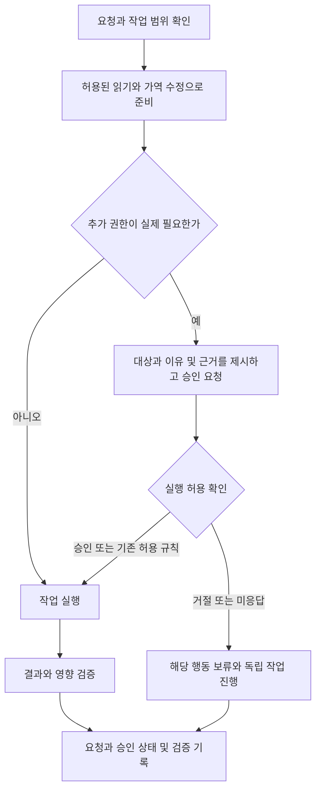

# 승인 요청 흐름과 오늘 사용한 개발 기술

이 문서는 승인 요청을 이해하고, 오늘 사용한 기술을 직접 설명하고 재현할 수 있도록 정리한 개인 개발 학습 자료다. 서비스 사용자용 학습 콘텐츠와 구분한다. 날짜 기준은 2026-11-05 Asia/Seoul이다.

## 승인을 왜 요청하는가

‘이 기능을 고쳐 달라’는 작업 허용과 실행 환경이 허용하는 파일·네트워크 접근 범위는 별개다. 프로젝트 안의 가역적 수정은 이미 요청한 작업의 범위에서 진행하지만, 보호된 경로에 쓰거나 차단된 네트워크 접근이 필요하면 실행 도구의 권한 승인이 필요할 수 있다.

실제 요청은 아래처럼 구체적이어야 한다. ‘계속해도 될까요?’만 묻기보다 대상·행동·목적·제한 출처를 알려야 사용자가 판단할 수 있다.

> 작성한 스킬을 프로젝트의 보호된 .agents 폴더와 개인 공통 스킬 폴더에 설치할까요? 프로젝트 .agents는 쓰기가 차단됐고 개인 폴더는 작업공간 밖이라 쓰기 권한이 필요합니다.

기록을 위해 승인 절차를 추가하는 것은 아니다. 승인받은 범위 안에서 할 수 있는 준비를 먼저 끝내고, 실제로 필요한 행동 직전에 요청한다. 이미 허용된 동일 범위라면 같은 질문을 반복하지 않는다.

## 승인 전후 흐름

동의가 필요한 상태에서 시간이 지났다는 이유로 승인으로 보지 않는다. 자동 승인 검토가 거절했다면 행동과 제공된 이유를 기록하고 같은 권한을 다른 도구로 우회하지 않는다. 프로젝트나 스킬 때문에 승인이 필요하다면 해당 파일·조항과 해석을 구분해서 설명해야 한다.

## 오늘 확인 가능한 승인 사례

아래는 대화/도구 결과에서 확인한 사건이다. 사용자 버튼 클릭 내역이나 모든 이전 세션의 승인 건수·정확한 시각까지 확인한 기록은 아니다.

| 행동 | 목적과 필요 근거 | 준비와 요청 범위 | 확인한 결과 |
|---|---|---|---|
| localhost 미리보기 서버 실행 | 페이지 실제 동작 검증. 샌드박스에서 로컬 소켓 접근 오류 발생 | 변경 코드와 테스트를 먼저 준비하고 지정 포트의 로컬 서버 실행 요청 | 권한 확대 실행 후 브라우저로 접속·검증. 종료 후 서버 정리 |
| 고정 버전 Prettier 일회 실행 | 압축된 수작업 코드의 일관된 서식. 샌드박스 npm 요청에서 ENOTFOUND 확인 | Prettier 3.6.2와 지정 파일 범위. 프로젝트 실행용 패키지 의존성 추가 없이 개발 도구 실행 | 버전 확인과 포맷 성공, 뒤이어 구문/회귀 검사 통과 |
| 개발 성장 기록 스킬 설치 | 다른 작업에서도 학습 기록 재사용. 프로젝트 .agents 쓰기에서 PermissionError, 개인 폴더는 작업공간 밖 | 내용이 있는 설치 스크립트를 먼저 작성하고 프로젝트/개인 스킬 폴더 쓰기 요청 | 두 경로에 설치 성공. 명시적 사용자 클릭인지 기존 허용인지 도구 출력만으로는 구분하지 않음 |
| 스킬 검사 의존성 다운로드 | 공식 형식 검사기가 PyYAML 부재로 중단됨. 일반 실행에서 패키지를 받지 못함 | PyYAML 6.0.3을 `work/skill-validation-deps`에만 설치. 시스템 Python이나 앱 의존성은 변경하지 않음 | 권한 확대 실행 후 설치 성공. 프로젝트/개인 두 스킬 모두 공식 검사 통과 |

실행 권한 확대, 대상 경로의 접근, 외부 데이터 전송/배포는 같은 의미가 아니다. 로컬 미리보기나 스킬 설치 허용이 Git·배포·메일 전송 허용까지 확장되지는 않는다. 이 프로젝트는 사용자가 Git을 관리하므로 이번에도 Git 작업을 하지 않았다.

## 계속 실행되는 것과 한 번 실행하는 것

도우미 초기화는 창을 열 때 브라우저 DOM의 입력과 결과만 바꾸는 일이다. 서버 요청을 만들지 않는다. 포매터·검사 명령은 실행할 때만 동작하는 개발 도구다. 스킬은 반복 작업 지침 파일이며, 설치했다고 백그라운드에서 매일 문서를 생성하는 서비스가 실행되지는 않는다. Codex가 해당 개발 작업에서 지침을 읽고 기록한다.

## 오늘 사용한 기술을 어떻게 이해할까

| 기술·위치 | 핵심 개념과 선택 이유 | 대안이 유리한 조건 | 직접 해볼 연습과 성공 기준 |
|---|---|---|---|
| IIFE 모듈, reference-pages.js | 함수 범위로 내부 구현을 감추고 create API만 노출. 빌드 없는 파일 열기를 유지하며 책임 분리 | 복잡한 의존성·여러 개발자가 늘면 ES modules/번들러·프레임워크 검토 | 모듈이 읽는 입력과 반환 API를 그려보고 전역 상태를 직접 복제하지 않는지 확인 |
| getState 의존성 주입 | 화면이 오래된 상태 객체를 잡지 않고 현재 값을 읽음. 가져오기·초기화 후 참조가 교체되는 문제 해결 | 상태가 더 복잡하면 전용 상태 관리 구조 검토 | 상태 객체를 교체한 뒤 검색/읽음 화면이 새 값을 보여주는지 test-reference-pages.cjs로 확인 |
| 콜백과 이벤트 | 게임/오늘의 학습은 판정을 전달하고 앱이 저장 출처를 결정. 화면·저장 중복을 줄임 | 기능 간 이벤트가 커지면 명시적 이벤트 계층/컨트롤러 검토 | 산성비 건너뜀이 어느 함수와 오답 출처로 이어지는지 코드에서 따라가기 |
| 순수 규칙 모듈 | core, review-core, wrong-notebook은 계산·정제·규칙을 UI와 분리해 테스트 | 중앙 공유·인증이 필요하면 같은 규칙을 서버에서도 검증 | 오답 한 항목을 두 출처에 넣고 한 출처만 완료해 다른 출처가 남는지 확인 |
| localStorage와 JSON 호환 | 작은 개인 기록을 브라우저에 저장, 백업은 검증 후 가져옴 | 계정·자동 동기화·중앙 복구가 필요하면 서버 저장 | 원본 백업을 보관한 뒤 별도 테스트 주소에서 가져오기 왕복. 파일/localhost/공개 주소 기록이 다른 이유 설명 |
| IndexedDB·Blob·ZIP | 개인 원본 파일과 메타데이터를 보관. 단순 학습 JSON과 용도가 다름 | 여러 기기의 파일 공유나 관리자 검수가 필요하면 권한 있는 서버 저장소 | 파일 보관과 자동 문항 파싱의 차이를 설명하고 동일 파일 중복 처리 확인 |
| Prettier와 Node 내장 테스트 | 서식 일관성과 동작 검증을 분리. 예쁘게 정리됐다고 올바른 코드인 것은 아님 | 팀 개발이면 승인된 고정 개발 의존성과 자동 검사 도입 | node scripts/check-site.cjs 실행 후 무엇을 검사했고 실제 기기 확인은 왜 별도인지 설명 |
| Service Worker | 네트워크/오프라인 자산 캐시와 개인 학습 저장소를 구분 | 설치·오프라인이 필요 없으면 생략 가능 | 캐시 삭제와 학습 기록 삭제가 왜 다른지 설명. 실제 설치 앱 업데이트는 별도 검증 |
| AGENTS.md와 SKILL.md | 전자는 프로젝트의 지속 규칙, 후자는 재사용 가능한 특정 작업 절차. 규칙의 범위를 구분 | 작업이 단발성이면 스킬을 늘리기보다 결과 문서만 작성 | 새 기능 수정 시 기록할 문서와 모듈 책임을 지침에서 찾아보기 |

위 실습은 사용자에게 제안한 학습 과제다. 사용자가 이미 수행하거나 이해했다고 판정한 것이 아니다.

## 이번 작업에서 알아둘 한계

전역 app.js의 문제풀이/설정 처리는 아직 더 분리할 수 있다. 자동 테스트가 통과해도 모든 실제 기기·공식 정답·운영 문의 흐름까지 검증된 것은 아니다. 코드 컨벤션은 유지보수 비용을 줄이는 약속이지 형식만 맞으면 품질이 보장되는 법칙이 아니다.

## 앞으로 기록하는 방식

개인 스킬 호출 이름은 `$development-learning-log`다. 현재 프로젝트에는 같은 스킬의 프로젝트 보관본이 있고 AGENTS.md에서 적용하도록 연결했다. 개인 설치본은 다른 프로젝트에서도 발견할 수 있는 위치에 있다. 동일 이름의 두 사본은 자동 병합되지 않으므로 스킬 자체를 바꿀 때 두 내용을 함께 확인한다.

스킬 선택은 작업과 설명의 일치에 따라 달라질 수 있으므로 다른 프로젝트에서도 확실히 적용하고 싶으면 위 이름으로 호출한다. 목록에 갱신이 보이지 않으면 Codex를 다시 시작해 확인할 수 있다. 이 동작과 스킬 위치는 [공식 스킬 안내](https://learn.chatgpt.com/docs/build-skills)를 확인했다. 현재 프로젝트에서는 AGENTS.md가 지속 기록의 진입점이다.
