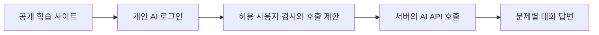

# 문제를 이해하기 위한 개인용 AI 도우미 검토

상태: 설계 검토. API 연결·AI 화면·서버 구현·계정 생성·유료 호출·배포는 아직 수행하지 않았다.

## 실제 문제

소스의 자체72문항과 기출850문항을 합친 922문항 중 해설 문자열이 빈 문항은 0개였다. 그러나 800문항은 “COMCBT 문제지의 정답표 기준 … 별도 상세 해설은 원문 자료실을 참고하세요.”라는 안내여서 상세 설명으로 볼 수 없다. 현재 공부 도우미도 생성형 AI가 아닌 기능/용어 검색이다. 문자열의 존재를 설명 품질로 간주하면 사용자의 불편을 놓친다.

사용자는 해설의 분량 확대보다 문제를 두고 질문·반문·자기 설명을 이어가는 방식을 원한다. 사용 범위 질문에는 “우선 나만 사용 — 비용과 설명 품질부터 확인”을 선택했다. 이후 공유 GitHub Pages를 내려야 하는지 질문했다.

## 제안 흐름

문제 해설 옆에서 AI에게 질문 → 문제·보기·선택한 답·정답 검수 상태를 확인 → 쉬운 설명/오답 이유/내 설명 확인 → 추가 질문. 원래 정답과 AI 설명을 분리하고 AI가 원본 정답이나 학습 기록을 변경하지 않게 한다. 답변이 확인되지 않은 주장임을 표시하며 그림을 전달하지 않았다면 그림 내용을 추측하지 않게 한다. 실전 채점 전에는 해설을 노출하지 않는다.

대화는 문제 단위의 일시적 상태로 관리하고 닫기/문제 변경 시 초기화한다. 전체 오답노트·메모·개인 파일을 자동 전송하지 않는다. 질문을 전송할 때 해당 문항과 대화가 외부 AI 제공자에 전달된다는 안내가 필요하다.

## 공개 사이트는 유지할 수 있다

GitHub Pages는 정적 HTML/CSS/JS 제공 역할로 유지한다. AI는 별도의 서버 API에서 호출하고 API 키는 서버의 비밀 값으로 보관한다. 본인 인증과 허용 사용자 검사는 서버에서 수행한다. 버튼을 숨기는 것·공개 JS의 비밀번호·CORS 제한만으로 개인 전용이 되지는 않는다.

개인용 서버를 로컬에서만 실행하는 방법도 있지만 컴퓨터의 localhost를 휴대폰의 localhost로 볼 수는 없다. 휴대폰에서도 항상 사용하려면 개인 인증을 갖춘 HTTPS 서버가 필요하다. 공개 학습 페이지의 중단/이전은 필수가 아니다.

선택 가능한 서버 예시는 Cloudflare Workers와 인증 계층이다. 현재 특정 공급자 도입을 확정하거나 연결하지 않았다. API 제공자·모델·예산·개인 인증 방법을 정한 뒤 구체화한다. API 키를 HTML/JS나 문서에 넣지 않으며 사용자가 채팅에 키를 붙이도록 요청하지 않는다.

## 검증 기준과 남은 일

- 실제 질문 사례로 이해에 도움이 되는지 평가: 비유 요청, 오답 비교, 자기 설명 반례, 다시 설명하기.
- 공식 정답 미확인과 구 출제기준을 답변에 반영하는지 확인.
- 본인 외 요청 거부, 요청 길이/횟수/출력 제한, 오류 시 기존 풀이 정상 작동, 대화 초기화 검증.
- 원본 해설/정답은 그대로 유지하고 AI 답변을 확인된 해설로 자동 저장하지 않는다.
- 아직 실제 모델 응답·비용·휴대폰 연결·인증은 검증하지 않았다.

## 확인한 공식 자료

- [GitHub Pages의 정적 호스팅 역할](https://docs.github.com/en/pages/getting-started-with-github-pages/what-is-github-pages)
- [Cloudflare Workers의 비밀 값 저장](https://developers.cloudflare.com/workers/configuration/secrets/)
- [OpenAI Responses API 입력·출력 제한·store 설정](https://developers.openai.com/api/reference/resources/responses/methods/create)

OpenAI 문서 스킬을 읽고 공식 API 페이지를 열어 확인했다. 사용 가능한 API 키 도구는 발견하지 못했다. 이 단계에서 유료 API 실행이나 키 탐색은 하지 않았다. store:false는 앱 대화 보관 설정 중 하나이며 모든 제공자 로그/보관이 없다는 보증으로 설명하지 않는다.

학습 포인트: 정적 화면과 비밀 값을 가진 서버의 책임을 분리하는 이유를 이해한다. 연습은 공개 JS에서 서버 호출 주소가 보이더라도 인증 없는 호출이 거부되는지 확인하는 것이다. 이 연습은 향후 구현의 확인 기준이며 현재 완료한 검증이 아니다.

## 후속 제안: 검토된 해설 지식베이스를 먼저 만들기

사용자는 모든 문제를 분석한 자료를 미리 만들고, 나중에 가벼운 공개 모델로 로컬 AI를 구성하는 방향을 제안했다. 이 단계에서는 실제 전 문항 분석/지식베이스 생성/학습을 수행하지 않았다.

RAG는 모델이 답할 때 자료를 찾아 문맥으로 제공하는 방식이며 모델 가중치를 바꾸는 파인튜닝과 다르다. 현재처럼 문제별 정답·해설·출제기준을 추적하고 수정해야 하는 경우 지식베이스를 우선 구축하는 방안을 제안한다. 파인튜닝은 이후 충분한 품질 평가를 거쳐 설명 방식·형식 등 특정 행동을 조정할 필요가 확인될 때 검토한다.

### 데이터 분리 제안

1. 문항 해설: 기존 questionId, 정답 근거, 각 보기의 판단/조건, 단계별 풀이, 비유, 암기 단서, 자주 하는 반문, 개념 ID, 원문/그림 의존성, 출제기준, 출처와 확인일, 검토 상태.
2. 공통 개념: conceptId, 한 주제 단위 설명, 혼동 개념 비교, 계산 예시, 관련 문제 ID. 동일 프로토콜 설명을 문항 수만큼 중복 복제하지 않는다.
3. 평가용 질문: 재진술·새 조건·후속 질문·정답 근거 부족 사례와 평가 기준. 조정용 데이터와 평가 데이터를 분리하고 원문 반복 정답률을 일반 이해 능력으로 해석하지 않는다.

빈 설명을 AI 초안으로 채우는 것과 검토된 해설을 확보하는 것을 구분한다. 초안/근거 확인/검토 완료/보류를 추적하고, 이미지 누락·공식 정답 미확인·구 출제기준은 보류 사유로 남긴다. AI가 초안을 작성했다는 사실만으로 정확성 검증을 대체하지 않는다.

현재 문제를 묻는 경우 questionId로 해설을 직접 조회하면 된다. 관련 개념에 대한 자유 질문이 늘면 키워드 검색, 이후 필요할 때 임베딩/벡터 검색을 추가한다. 시작부터 벡터 DB나 모델 학습이 필수는 아니다. 사람이 읽는 원본 JSON/Markdown과 검색용 파생 인덱스를 분리하면 모델/임베딩을 바꿀 때 인덱스만 재생성할 수 있다.

### 단계와 운영 경계

대표 30~50문항으로 해설 형식·후속 질문·검토 비용을 먼저 평가 → 기존 922문항으로 확대 → 정적 해설과 검색에 연결 → 로컬 추론 모델 연결 → 필요성이 검증될 때 파인튜닝. 제안한 시범 수는 진행 계획이며 실제 수행 수가 아니다.

정적 해설은 기존 GitHub Pages에서 제공할 수 있다. 로컬 모델 추론은 별도다. 개인 PC에서 모델과 검색을 실행하고 휴대폰을 접속시키는 형태와 휴대폰 자체에서 모델을 실행하는 형태는 요구 자원이 다르다. 공개 가중치 모델도 라이선스·한국어 설명 품질·RAM/VRAM·속도를 확인해야 한다. 양자화는 메모리 요구를 줄일 수 있으나 기기별 품질/지연을 보증하지 않는다. 모델 선정·설치·외부 서버 공개는 하지 않았다.

공식 개념 근거:
- [Microsoft RAG와 파인튜닝 선택](https://learn.microsoft.com/azure/ai-studio/concepts/retrieval-augmented-generation)
- [Hugging Face 양자화 개요](https://huggingface.co/docs/transformers/main/quantization/overview)

## 개인 AI의 API 비용 예시

2026-11-14 공식 요금표 Standard/짧은 문맥 기준을 확인했다. GPT-6 Luna는 입력 $0.10/출력 $0.50, GPT-6.1 Sol은 입력 $2/출력 $10(각 100만 토큰당)이다. 모델 선정 확정이나 실제 한국어 해설 품질 비교는 하지 않았다. 과거 GPT-4.1 mini 페이지에는 Deprecated 표시가 있어 신규 기본 추천으로 사용하지 않았다.

매 요청마다 전체 입력3000토큰(지침·현재 문제·검색 자료·이전 대화 포함), 전체 과금 출력1000토큰이라고 가정하면 Luna $0.0008/회, Sol $0.016/회다. 1000회는 $0.80/$16, 하루100회×30일은 $2.40/$48다. 호출 횟수는 사용자 질문 한 번에 모델 요청 한 번인 경우다. 추론/재시도/복수 호출/이미지/웹 검색·파일검색 도구/서버·인증/세금/환율을 추가하면 달라진다. 글자 수가 토큰 수와 같지 않고 과금 출력에 추론 토큰이 포함될 수 있어 실제 사용량 계측이 필요하다. 이 수치는 지출 상한이나 모델 설명 정확도의 보증이 아니다.

개인 인증, 서버에서 하루 횟수·입력/출력·동시 요청 제한, 대화 길이 제한, 검토된 기본 해설 재사용, 모르는 문제에만 질문하기로 비용을 관리하는 방안을 제시했다. $5 등 작은 시험 예산은 사용자와 정할 운영 목표이며 결제/충전을 실행하지 않았다. 제공자의 예산 알림만으로 요청을 차단하는 하드 상한이 된다고 가정하지 않는다.

현재 공식 안내에는 자격 있는 Pro/Business 구독자의 API 크레딧 신청 혜택이 있다. 사용자의 요금제/자격/활성화 상태는 확인하지 않았고 자동 적용이나 API 무료를 보장하지 않는다.

- [공식 요금표](https://developers.openai.com/api/docs/pricing)
- [구독자 API 크레딧 조건](https://developers.openai.com/api/docs/guides/chatgpt-api-credits)

## 현재 우선 제약: 무료·API 키 관리 없음·인증 토큰 관리 없음

사용자 후속 지시를 반영한 현재 기본 방향이다. 앞선 유료 API·로그인 서버 제안은 채택된 구현이 아니며 현재 우선안에서 제외한다.

- 사용자에게 API 키 발급/입력/보관이나 인증 토큰 관리를 요구하지 않는다.
- 유료 API 호출, 외부 모델 제공자 계정 연결, 클라우드 모델 자동 대체를 기본 동작에 넣지 않는다.
- 기존 PC의 로컬 모델과 로컬 검색 데이터를 사용한다. 모델 다운로드·라이선스·저장 공간·전력은 별도 조건이며 모든 물리적 비용이 0이라는 뜻은 아니다.
- 우선 연결 범위는 동일 PC의 loopback으로 한정한다. 페이지도 로컬에서 제공해 같은 출처로 연결하는 구성을 우선 검토한다. Host/Origin·요청 크기·입력 검증은 토큰이 없어도 필요한 서버 보호다.
- 인증을 없앤 AI 서버를 0.0.0.0이나 공인 주소로 공개하지 않는다. 공개 사이트에서 버튼을 숨기는 것으로 보호했다고 보지 않는다.
- 공개 GitHub Pages의 기존 학습 기능은 유지할 수 있다. 공개 사이트에서 모든 방문자가 본인의 PC 모델을 자동 이용하거나 PC를 끈 뒤에도 휴대폰에서 AI가 동작하는 구조는 아니다.
- 휴대폰 외부 접속/공유 AI는 별도 요구로 검토한다. 무인증 공개를 무료·무관리의 해결책으로 제안하지 않는다.

Ollama 공식 FAQ의 local-only 설정을 확인했다. 이 단계에서 Ollama·모델을 설치하거나 로컬 AI 연결을 구현한 것은 아니다. PC 사양 확인을 위해 Get-CimInstance Win32_ComputerSystem/Win32_VideoController를 시도했으나 CIM 리소스 접근 불가로 실패해 RAM/GPU를 확인하지 못했다. 권한 확대나 다른 도구를 통한 제한 우회는 하지 않았다. 사용할 모델과 실제 속도는 아직 확정할 수 없다.

공식 근거: [Ollama FAQ](https://docs.ollama.com/faq). 이후 모델 선정 시 클라우드 모델과 로컬 모델을 구분하고 라이선스·한국어 해설 품질을 확인한다.

## 기존 홈랩 로컬 AI 재사용 가능성

사용자 제공 설명에는 Python 표준 라이브러리 대화 서버, 기존 Ollama, qwen2.5-coder:7b 양자화 모델, PC RTX5070/32GB, SQLite 대화, 스트리밍과 같은 공유기 LAN 휴대폰 연결이 이미 구현되어 있다고 기재되어 있다. 이는 사용자 제공 자료이며 현재 실행 환경에서 독립 확인한 사실은 아니다. 합성 코딩 벤치마크의 속도는 네트워크 시험 해설 정확도/지연을 보장하지 않는다. 제공된 임시 연결 코드와 대화 식별자는 비밀/개인 값으로 기록에서 제외했다.

별도의 유료 API를 구축하기보다 이 추론 서버를 재사용하고 문제별 문맥/검토된 해설을 전달하는 연결을 검토할 가치가 있다. 현재 모델의 한국어 설명·보기별 판단은 실제 문제 묶음으로 평가해야 하며 파인튜닝이 선행 조건은 아니다.

API 명세의 경로만 읽으려고 사용자가 제공한 사설 호스트의 /docs/openapi.json에 접근했으나 소켓 접근 권한 오류로 실패했다. 서버가 꺼졌거나 연동 불가능하다고 판정할 근거는 아니다. 연결 코드로 로그인하거나 대화 기록/관리 설정을 읽지 않았다. 다른 도구로 제한을 우회하지 않았다.

공개 HTTPS GitHub Pages에서 사설 HTTP AI 서버를 직접 fetch하는 구성은 혼합 콘텐츠와 출처 제한을 고려해야 한다. 대안은 로컬 AI 서버가 시험 화면을 별도 경로에서 함께 제공하고 같은 출처의 기존 대화 API를 사용하도록 하는 것이다. 이는 향후 설계안이며 실제 API 계약과 기존 서버의 정적 파일 처리·인증 경계를 확인해야 한다. 기존 서버의 전체 대화/관리 설정 공유 대신 시험 질문의 문맥만 전달하도록 범위를 좁힌다. 기존 LAN 연결 코드/쿠키를 제거하거나 공개 JS에 넣지 않는다. 새로운 공급자 API 키나 사용자가 별도로 관리하는 인증 토큰을 추가할 필요는 없다.

참고: [MDN 혼합 콘텐츠](https://developer.mozilla.org/en-US/docs/Web/Security/Defenses/Mixed_content). 기존 공개 사이트는 유지하고 로컬 AI 기능은 집 안 접속 경로에서만 사용하는 구성이 우선안이다. 공개 인터넷 노출·방화벽·서비스/모델 설정 변경은 하지 않았다.

사용자는 불가능하면 진행 작업을 취소하라고 조건을 추가했다. 구성상 재사용 후보이지만 실제 연동을 확인한 상태는 아니다. 현재 실행 중인 설치·학습·유료 호출·서버 수정 작업은 없으며, 검증되지 않은 연동을 계속 구축하지 않았다. 이미 완료한 시험 사이트 리팩토링을 이 조건만으로 되돌리지 않는다.

## 위험한 정보와 기능을 처음부터 줄이는 설계

사용자는 시험 사이트에 로그인이나 불필요한 저장을 추가하지 않고 공격 표면과 민감 정보 취급을 최소화하길 원한다고 설명했다. 보안 장치를 우회한다는 의미가 아니라, 인증/비밀 값/서버가 필요한 기능을 줄이는 방식으로 해석한다.

현재 우선 제안:

1. 공개 시험 사이트는 로그인·유료 AI 키·공개 AI 중계 API·서버 대화 DB 없이 정적 학습/검토된 해설/검색을 제공한다.
2. 가장 결합이 적은 AI 사용은 문제·보기·내 답만 복사해 사용자가 기존 로컬 AI에 붙여넣는 흐름이다. 사이트는 사설 AI 서버 주소/연결 코드/대화 ID를 저장하거나 자동 접속하지 않는다. 이 버튼은 아직 구현하지 않았다.
3. 사이트 안에서 직접 대화가 필요해지면 집 안의 별도 로컬 실행 경로에서만 검토한다. 서버가 없거나 인증이 없다는 이유만으로 무인증 LAN/인터넷 공개를 허용하지 않는다. LAN과 로컬 PC 전용은 구분한다.
4. AI 대화는 메모리에서만 유지하는 모드를 우선 제안한다. 실제 서버에서도 SQLite 쓰기·요청/응답 로그·백업·캐시를 점검해야 무저장이라고 표현할 수 있다. 화면 초기화만으로 서버 저장이 없어지지 않는다.
5. 제공된 홈랩 문서에는 SQLite 대화 저장과 여러 기기의 기록 공유가 명시되어 있다. 현재 서버가 무저장이라고 가정하지 않는다. 기존 기록이나 인증 방식을 이번 논의만으로 삭제/변경하지 않는다.
6. 기존 시험 오답/진도 localStorage는 사용자에게 유용한 기존 기능이며 AI 대화 무저장과 별개다. “굳이 저장할 필요가 없다”는 표현만으로 학습 상태를 삭제하거나 모든 저장을 비활성화하지 않는다. 필요하면 향후 별도 임시 학습 모드를 논의한다.

남는 위험은 없다거나 무해하다고 보증하지 않는다. 정적 사이트에도 입력 HTML 처리·외부 링크·의존성 관리가 필요하다. 새 코드는 기존 이스케이프 규칙을 따르고 외부 실행/파일 접근 기능을 AI에 추가하지 않는다.

기술 학습: 데이터 최소화와 기능 분리는 보안 관리 대상을 줄인다. 무저장 검증은 브라우저 상태뿐 아니라 서버 DB/로그/캐시까지 관찰해야 한다. 현재는 설계 제안이며 무저장 모드 구현/검증 완료가 아니다.
